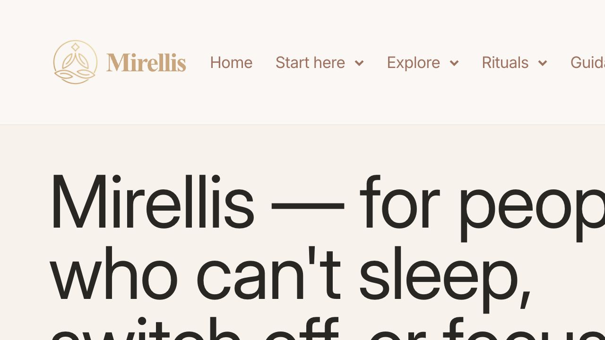
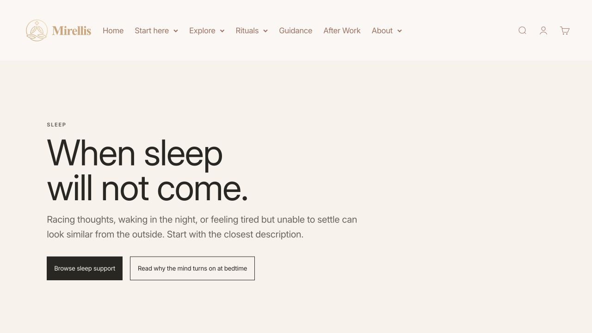
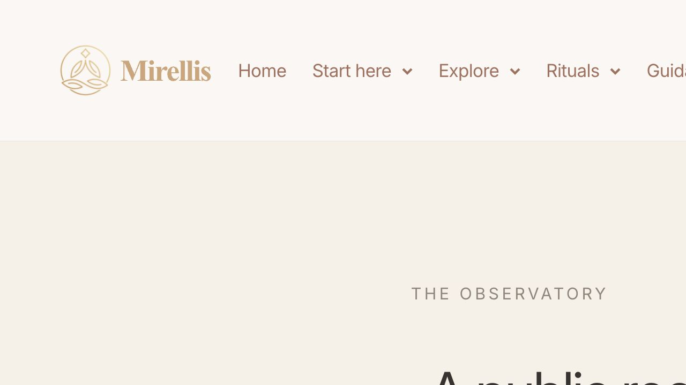
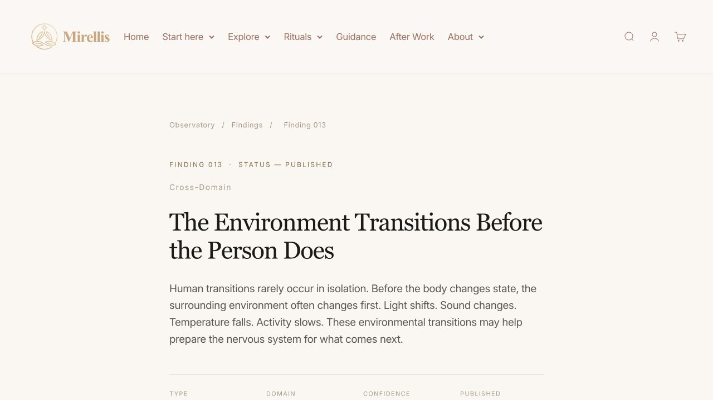
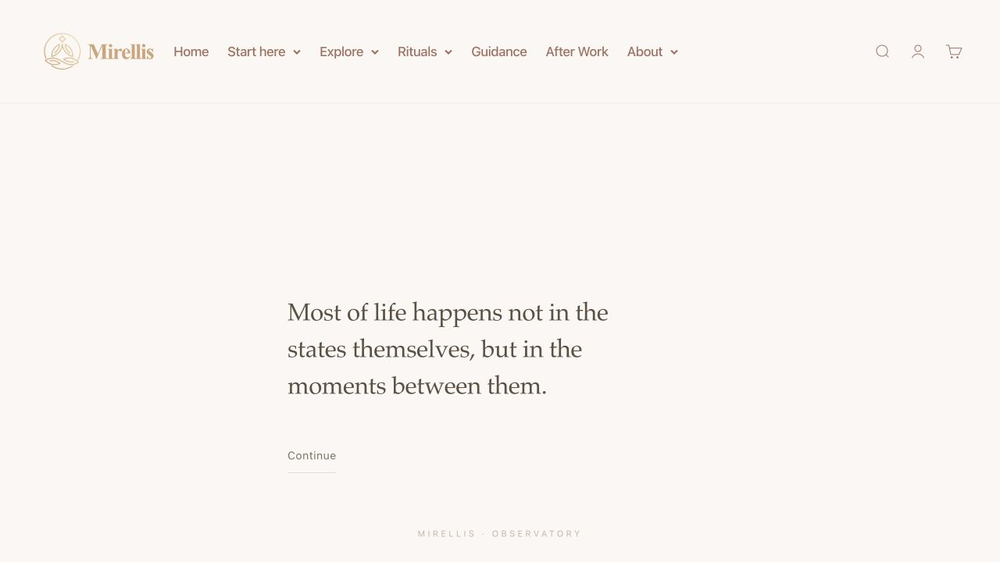

# Mirellis Authority, Architecture and Contributor-Readiness Audit

Date: 19 August 2026  
Scope: public `mirellis.in` experience, active Shopify theme, public research surfaces, sitemap architecture, authority signals, observation submission, proposed expert-contributor workflow, SEO/GEO readiness, accessibility risks and implementation sequence.  
Production changes: none.

## Executive verdict

Mirellis is not ready to begin a serious authority-backlink campaign yet.

The site has a distinctive visual language and a potentially valuable institutional concept. The strongest existing surface is the individual Finding page: it looks composed, deliberate and recognisably Mirellis. The problem is not that the site looks illegitimate everywhere. The problem is that the institutional promise is stronger than the visible proof and operating system behind it.

The launch blockers are structural:

1. The public architecture contains overlapping generations of Mirellis.
2. Research pages lack named authors, reviewers, source registers and citation tools.
3. “Published,” “open,” “active,” and “confidence” labels are not governed by one visible taxonomy.
4. The public submission experience collects observations; it is not an article-contributor or editorial-review system.
5. Generic Shopify customer login is unrelated to expert contribution and should not be presented as if it were.
6. Important brand facts in structured data and contact surfaces still describe an older Mirellis.
7. The live site has 175 sitemap URLs across several overlapping content families, including legacy and result-state pages.

Recommendation: preserve the brand direction, correct the responsive/layout defects, consolidate the information architecture, create the visible authority layer, and build a moderated contributor studio before outreach.

## What was inspected

- Active Shopify theme: `Mirellis Problem-first Homepage 2026-08-18`, theme ID `145113481282`.
- Public homepage and first problem route.
- Observatory landing, Findings archive, a published Finding and How We Work.
- Observatory Mirror and Living Observatory submission paths.
- Public XML sitemaps, `robots.txt`, `agents.md`, page metadata and Organization structured data.
- Public client implementation of the Living Observatory submission surface.
- Current Google guidance on authorship, evidence and third-party content.
- COPE publication-governance principles, W3C form guidance, Supabase authentication/RLS guidance and OWASP upload security guidance.

## Evidence screenshots

### Step 1 — Public homepage: needs correction

Strength: the problem-first framing is immediately understandable.

Risk: at the audited desktop viewport the headline is too large to be read as a complete thought, and the right side of the navigation is clipped. The first useful choices do not fully settle within the initial view. This communicates visual ambition but not operational polish.

### Step 2 — Problem route: healthy foundation

Strength: this is the clearest public page in the first-time journey. The title, explanation and two next actions are understandable.

Risk: it sends a person either to the directory or to a Journal article, but does not explain what Mirellis itself has verified, who reviewed the explanation, or how the route relates to the app’s now broader four-moment model.

### Step 3 — Observatory landing: structural duplication

Strength: the page attempts to communicate uncertainty and bounded claims.

Risks:

- Excessive empty vertical space pushes the actual proposition below the fold.
- The page contains two complete Observatory architectures in sequence: an initial three-territory landing and a second “public register” experience.
- The first section describes territories; the second section exposes only three records; the Findings archive contains substantially more records.
- A new visitor cannot reliably tell whether the Observatory is a research archive, a register, a community instrument or a product-learning system.

### Step 4 — Published Finding: visually strong, evidentially incomplete

Strength: this page has the strongest institutional visual tone on the site. The hierarchy, typography and restraint feel credible.

Missing authority signals:

- no named author;
- no named editor or reviewer;
- no affiliation or credential page;
- no visible bibliography or direct source links;
- no publication and modification dates;
- no explanation of what “Moderate” confidence means;
- no funding/conflict disclosure;
- no correction or revision history;
- no “cite this” export;
- no downloadable evidence register.

The page currently asks the reader to trust Mirellis’s synthesis without showing who performed it or the source trail that supports it.

### Step 5 — Mirror: valuable consumer instrument, not a contributor portal

Strength: calm, focused and private in tone.

Risk: this is a guided consumer reflection flow. It cannot be used as the place where a researcher, clinician or invited writer proposes, drafts, revises and tracks an article.

## Canonical architecture found

### Current public entry model

1. Sleep
2. Focus
3. Restoration

### Current institutional transition model

1. Sleep → Wakefulness
2. Work → Recovery
3. Stimulation → Restoration

### Current app model

1. Waking
2. Focus
3. After Work
4. Night

These models can coexist, but the relationships are not explained. The top navigation still labels the app “After Work,” even though the live app now covers four moments. This makes the system appear to have changed faster than its architecture and language.

## Information-architecture findings

The public sitemap currently exposes:

| Family | Indexed URLs |
|---|---:|
| Products | 3 |
| Shopify pages | 72 |
| Collections | 4 |
| Blogs/articles | 47 |
| Metaobject pages | 49 |
| Total | 175 |

Volume itself is not the problem. The problem is overlap and unclear canonical ownership.

Examples:

- `/pages/why-mirellis-exists` and `/pages/why-we-exist`
- `/pages/community`, `/pages/the-observatory-live`, `/pages/the-observatory-mirror`, and `/pages/personal-observatory`
- `/pages/finding-001`, blog-based Observatory Findings, and metaobject-based `/pages/findings/...`
- `/pages/observatory-dossiers`, blog-based dossiers, and metaobject-based `/pages/dossiers/...`
- Journal articles, Knowledge pages, Guides, Findings and Dossiers covering closely related questions without one visible content taxonomy
- assessment result and confirmation pages included in the page sitemap
- legacy institutional pages such as Institute, Public Notes and Research Domains existing beside the newer Observatory architecture

Required correction:

1. Assign one canonical purpose to each content type.
2. Redirect or `noindex` superseded routes.
3. Remove private/result-state pages from discovery surfaces.
4. Keep valuable historical URLs through permanent redirects.
5. Build one internal-link model around the canonical content families.

## Authority audit

### Strong foundations

- Distinctive subject area: Human State Transitions.
- Calm and recognisable visual language.
- Individual Findings have durable URLs and consistent titles.
- Limitations are acknowledged in parts of the Observatory.
- The sitemap is discoverable and major content is server-rendered.
- Core Web Vitals displayed in Shopify admin were healthy at the time of inspection.

### P0 authority gaps

1. **Authorship is invisible.** Health, sleep, focus and restoration are trust-sensitive subjects. Every substantive page needs a clear author and author profile.
2. **Evidence is asserted but not inspectable.** References must be linked to the exact claims they support.
3. **Review is invisible.** “Published” must not imply peer review unless the review model actually exists and is disclosed.
4. **Status vocabulary is inconsistent.** Publication state and evidence confidence must be separate fields.
5. **Counts contradict one another.** The Living Observatory says four findings; the archive lists many more; the Observatory public register shows three records.
6. **Brand facts are stale.** The homepage Organization schema still describes Mirellis with older Ayurveda/luxury wording and an older social profile, while visible pages position Mirellis as Ritual Science.
7. **Contact trust is stale.** The public contact surface still foregrounds `lambdalifestyle` and a legacy email identity instead of a dedicated Mirellis editorial/research contact.
8. **AI discovery is commerce-only.** `agents.md` explains how an agent can shop; it does not describe Mirellis’s research corpus, authors, methods or canonical institutional facts.

## Contributor-system audit

### What exists

The Living Observatory supports:

- an anonymous daily reflection;
- a short observation classified by transition;
- direct client requests to Supabase REST tables for votes, reflections and community submissions;
- wording that submissions are reviewed before entering the pool.

### What does not exist

- contributor-facing landing page;
- contributor guidelines;
- article formats and editorial scope;
- expert identity and credential verification;
- appropriate contributor authentication;
- saved drafts and previews;
- bibliography/DOI capture;
- conflict, funding and AI-use disclosures;
- copyright and licensing agreement;
- revision workflow;
- reviewer assignment;
- editorial decision records;
- contributor status dashboard;
- correction/retraction workflow;
- publication handoff into canonical Shopify content;
- press/media workflow.

### Security and privacy boundary

Exposing a Supabase project URL and publishable browser key is normal only when Row Level Security is correctly configured. This public audit cannot confirm the database policies. Before expanding submissions, Mirellis must perform a separate RLS, rate-limit, retention and abuse audit.

The observation form should not use the word “anonymous” unless Mirellis has confirmed exactly which IP, device, analytics and server metadata are or are not retained. Prefer “No name or email is requested” when that is the verifiable promise.

Observation consent, research-use consent and public-quotation permission must remain three separate choices. None should be preselected.

## Recommended public information architecture

The public site should teach five clear things:

1. What problem Mirellis helps with.
2. What Mirellis studies.
3. What Mirellis has learned and how it knows.
4. What a visitor can do now.
5. How a qualified person can contribute.

### Primary navigation

| Destination | Purpose |
|---|---|
| Start here | Sleep, Focus, Restoration and “Help me work it out” |
| Observatory | Findings, Evidence Notes, Method and Corrections |
| Get help | Mirellis app and practitioner directory |
| Contribute | Expert contribution, observation contribution and media enquiries |
| About | Mission, people, governance and contact |
| Rituals | Products, kept subordinate to the method |

Generic “Login” should not appear as a universal research action. Commerce accounts and contributor accounts have different purposes. Label commerce access “Shop account” inside commerce surfaces. Put “Contributor sign in” inside Contribute.

### Canonical content types

| Type | Job | Required proof |
|---|---|---|
| Finding | Mirellis institutional synthesis | author, reviewer, evidence status, citations, limitations, version history |
| Evidence Note / Dossier | detailed evidence register | search method, inclusion boundary, sources, dates, reviewer |
| Guide | practical reader explanation | author, reviewed-by, sources, safety boundary |
| Journal | timely essays and company updates | byline, date, disclosure; not presented as research |
| Expert Commentary | invited or accepted external interpretation | expert profile, conflicts, editorial note, references |
| Observation | private/raw input | never indexed or automatically published |

## Recommended contributor experience

Do not allow public self-publication. Use an open-submission, controlled-publication model.

### Public journey

1. **Contribute landing** — explains what Mirellis accepts, does not accept and why.
2. **Choose contribution type** — Expert Commentary or Evidence Note at launch. Keep observations in the separate Living Observatory.
3. **Read requirements** — scope, length, evidence expectations, review time, rights, disclosures and examples.
4. **Contributor sign-in** — passwordless email magic link; no Shopify customer account.
5. **Identity profile** — name, biography, affiliation, expertise, ORCID/website and credential evidence.
6. **Create submission** — title, abstract, transition/domain, article body, references and optional private files.
7. **Declarations** — originality, conflicts, funding, AI assistance, permissions and publication licence.
8. **Preview** — exact article preview plus completeness checks.
9. **Submit** — creates an immutable submitted version and a visible tracking ID.
10. **Track** — Draft, Submitted, Editorial Check, Revision Requested, Under Review, Accepted, Copy Edit, Scheduled, Published or Declined.

### Editorial journey

1. Completeness and scope triage.
2. Identity and credential verification.
3. Conflict and rights check.
4. Evidence/reference check.
5. Reviewer assignment when technical claims warrant it.
6. Structured revision request.
7. Editorial decision with rationale.
8. Copy edit and author approval.
9. Publish to canonical Mirellis content type.
10. Post-publication correction/version management.

### Required policies before opening submissions

- Editorial scope and independence
- Authorship and contributorship
- Peer/editorial review model
- Conflicts of interest and funding
- Evidence and citation standard
- AI assistance disclosure
- Originality, plagiarism and duplicate publication
- Copyright and licence
- Privacy, retention and deletion
- Corrections, expressions of concern and retractions
- Complaints and appeals
- Abuse and prohibited content
- Accessibility commitment
- Contributor fees/compensation, explicitly stating none if none

## Recommended backend architecture

### Keep

- Shopify for the public storefront and canonical SEO pages.
- Existing metaobject-based Findings/Dossiers as the publication destination after cleanup.
- Vercel for the authenticated contributor application and server-side workflow APIs.
- Supabase for authentication, Postgres workflow data and private object storage.
- Resend/custom SMTP for magic links and editorial notifications.

### Add

- `studio.mirellis.in` for contributors, reviewers and editors.
- Public `/pages/contribute` and policy pages on `mirellis.in`.
- Passwordless authentication using magic links.
- Role-based access: contributor, reviewer, editor and administrator.
- Server-side submission endpoint; do not extend the editorial workflow through unrestricted direct browser writes.
- Row Level Security on every contributor table.
- Private storage with signed, expiring file URLs.
- Rate limiting, CAPTCHA/Turnstile at abuse thresholds and an audit trail.
- Background publication job that writes only accepted records to Shopify through a narrowly scoped Admin API token.

### Core data model

- `profiles`
- `organizations`
- `credentials`
- `submissions`
- `submission_versions`
- `citations`
- `attachments`
- `disclosures`
- `review_assignments`
- `reviews`
- `editorial_decisions`
- `publication_records`
- `corrections`
- `consents`
- `audit_log`

Observation records must remain in a separate privacy and permission domain from editorial submissions.

### File-upload controls

- authenticated uploaders only;
- explicit allowlist such as PDF, DOCX and images;
- MIME and file-signature validation;
- generated storage filenames;
- strict size limits;
- private storage outside the public webroot;
- malware scanning before an editor opens a file;
- no ZIP files at launch;
- signed URLs and access logging.

## Required publication-page template

Every Finding, Evidence Note, Guide and Expert Commentary should display:

1. Content type and stable ID.
2. Title and bounded summary.
3. Author(s) linked to profile pages.
4. Reviewed by / edited by.
5. Published and last-updated dates.
6. Publication state and separate evidence confidence.
7. “What this says” and “What this does not say.”
8. Main argument.
9. Claim-level citations and full references.
10. Method or synthesis method.
11. Limitations.
12. Funding and conflicts.
13. AI-use disclosure where relevant.
14. Revision/correction history.
15. “Cite this” in plain text and BibTeX/RIS when appropriate.
16. Media/contact route.
17. Related Finding, Evidence Note, Guide and practical tool.

Google’s Article markup should mirror the visible author, dates, headline, publisher and canonical URL. Structured data must not make claims that are absent from the visible page.

## Visual-system correction

Do not redesign Mirellis into a generic academic journal. Preserve Playfair Display, Inter, warm neutrals and quiet pacing.

Change the system in these ways:

- one responsive header across homepage, Observatory, Findings, Journal and contributor pages;
- reduce homepage display type so the full proposition and first choices fit at 1280px;
- cap institutional page hero height so the purpose is visible without scrolling;
- use a 680–760px reading column for long research content;
- introduce denser evidence modules: reference lists, author cards, status definitions, change logs and citation tools;
- use evidence labels with text, not colour alone;
- remove animation from research-critical content or honour reduced motion;
- maintain 44px targets, visible focus and logical keyboard order;
- design and test 360, 390, 768, 1024, 1280 and 1440px states.

## SEO and GEO corrections before outreach

1. Rewrite stale Organization schema to the current Ritual Science positioning.
2. Add accurate `Article` markup to editorial pages with visible author and dates.
3. Create author profile pages and Person schema.
4. Consolidate duplicate routes with 301 redirects and canonical tags.
5. Remove result/private/thin legacy pages from the sitemap or apply `noindex` where appropriate.
6. Add direct, crawlable source links and descriptive internal anchors.
7. Create a public methodology page, editorial policy, corrections page and press/media factsheet.
8. Replace contradictory counts with data-driven counts from one source.
9. Update Contact, About, footer and social identities to one current institutional identity.
10. Give AI systems one canonical, HTML-accessible institutional facts page. Treat commerce-focused `agents.md` as commerce plumbing, not the Mirellis knowledge authority layer.

## Build order

### Phase 0 — Freeze and inventory

- Export every public URL, content owner, traffic/backlink status and canonical replacement.
- Freeze creation of new content families until taxonomy is approved.
- Audit current Supabase RLS, retention and moderation policies.

### Phase 1 — Trust repair

- Correct Organization schema, contact identity, social links and app naming.
- Define status/confidence taxonomy.
- Publish methodology, editorial, correction, conflict and authorship policies.
- Create founder/editor and reviewer profile structure.

### Phase 2 — Architecture consolidation

- Approve canonical sitemap.
- Merge or retire overlapping pages.
- Add redirects and remove result-state pages from indexing.
- Rebuild Observatory as one landing page, not two stacked systems.

### Phase 3 — Citation-ready templates

- Rebuild Finding, Evidence Note, Guide and Commentary templates.
- Upgrade five flagship assets completely before migrating the entire archive.
- Add structured data and citation downloads.

### Phase 4 — Contributor studio

- Build authentication, profile, draft, reference, disclosure and status workflows.
- Build editorial queue, revisions, review, decisions and publishing handoff.
- Run security, privacy and accessibility tests.

### Phase 5 — Controlled pilot

- Invite three to five trusted contributors.
- Observe completion time, confusion, review burden and revision quality.
- Correct the workflow before opening submissions publicly.

### Phase 6 — Outreach readiness

Begin backlink outreach only when all readiness gates below pass.

## Campaign-readiness gate

- [ ] One canonical public architecture is published.
- [ ] No contradictory Finding/record counts remain.
- [ ] Five flagship assets are citation-ready.
- [ ] Every flagship asset has named authors, reviewer, sources, dates, limits and citation tools.
- [ ] Methodology, editorial policy and corrections policy are public.
- [ ] Current Organization/Person/Article structured data validates.
- [ ] Contribute page explains scope and standards.
- [ ] Contributor portal supports drafts, revisions and tracking.
- [ ] No contributor content can auto-publish.
- [ ] RLS, upload security, rate limiting and moderation have been tested.
- [ ] Privacy wording matches actual data handling.
- [ ] Mobile and keyboard journeys pass.
- [ ] Press/media factsheet and editorial contact are live.
- [ ] Redirects and sitemap cleanup are verified.

## Accessibility evidence limits

The captured DOM showed meaningful landmarks, headings and named controls on the inspected pages. This is a good baseline.

This audit does not certify WCAG compliance. Keyboard focus visibility, contrast ratios, zoom/reflow, error recovery, screen-reader announcements and full mobile layouts require dedicated testing. The browser’s responsive viewport override did not apply reliably during this run, and screenshot capture repeatedly timed out on the long Findings, Method and Living Observatory pages. Those states were inspected structurally through their rendered DOM but must be recaptured in the implementation QA phase.

## Final decision

Do not start mass outreach yet. Do not rebuild the brand from scratch either.

The correct next project is **Mirellis Authority Infrastructure**: one canonical architecture, one governed publishing system, five citation-ready assets and one controlled contributor studio. Once that exists, backlink outreach will ask respected people to link to something that visibly deserves citation—and will give invited contributors a workflow worthy of their time.

