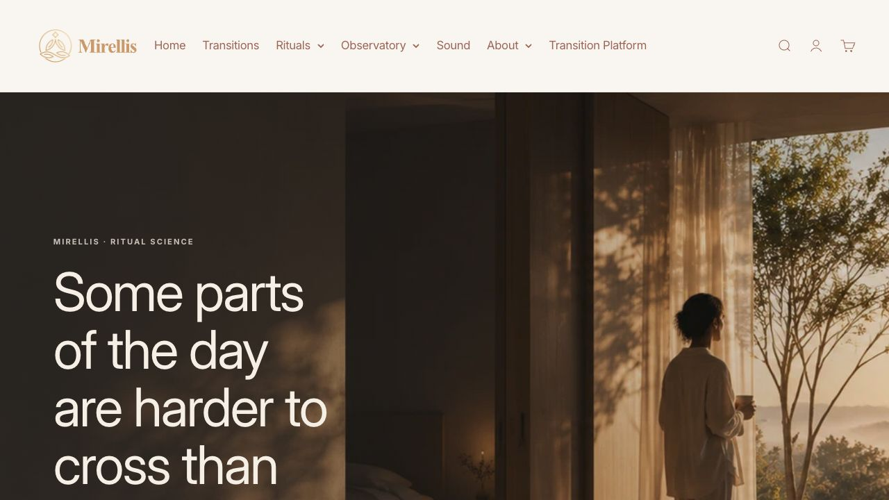
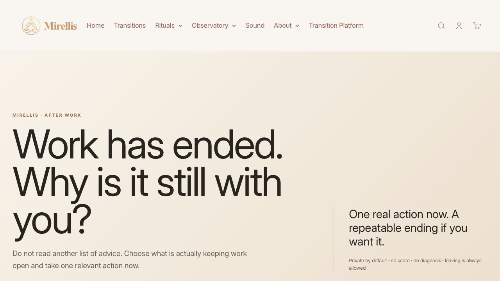
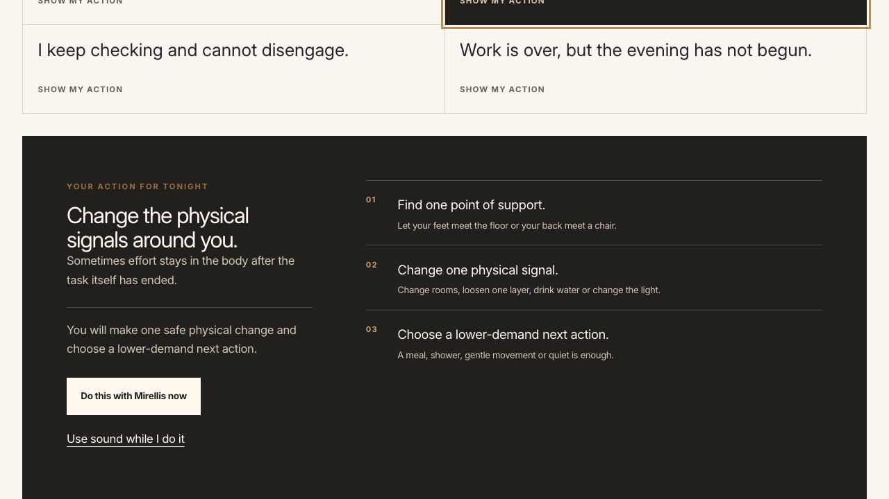
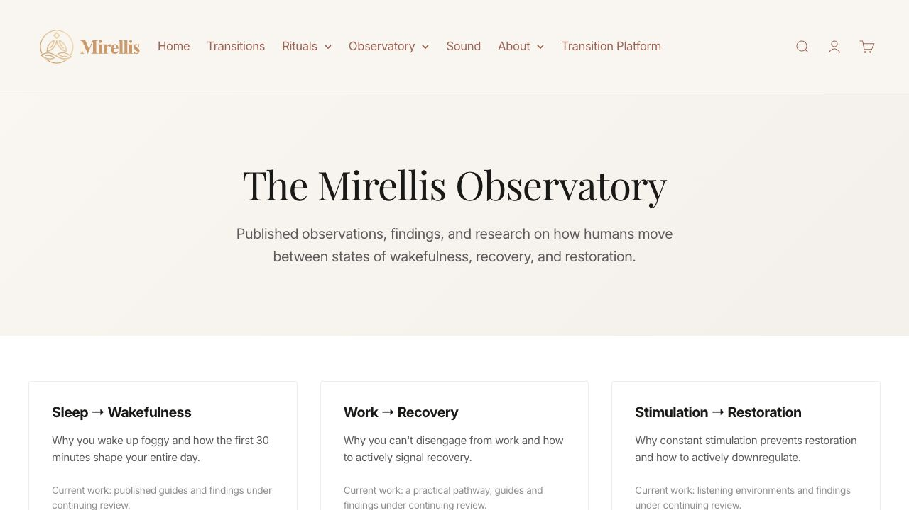
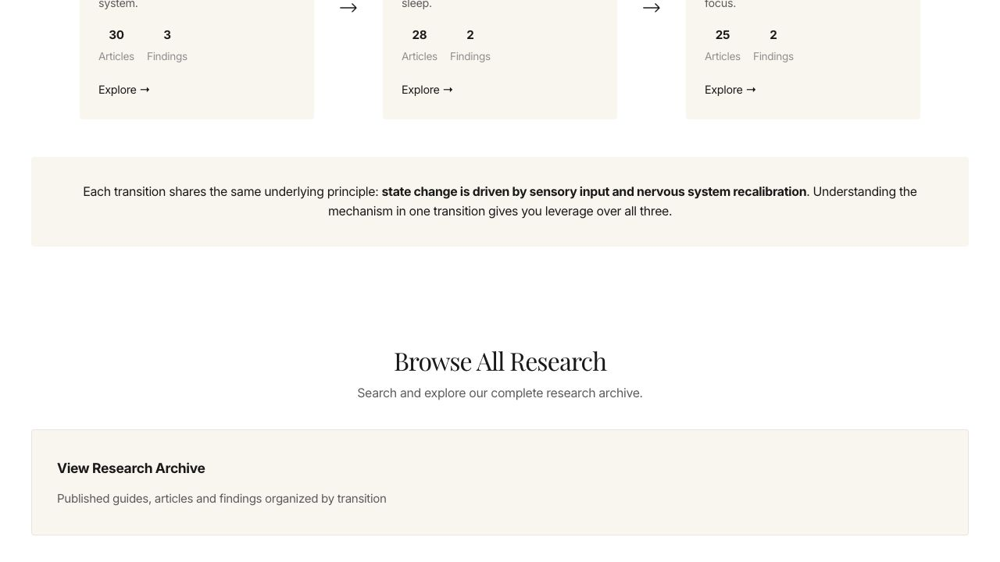
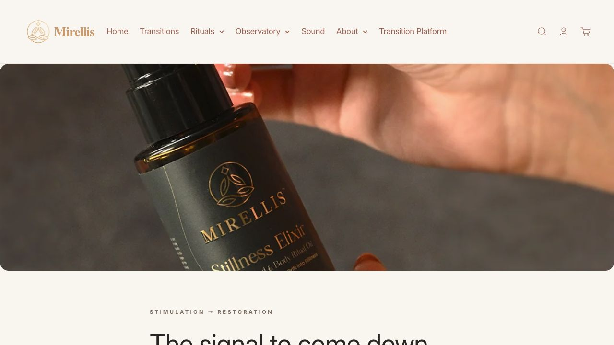
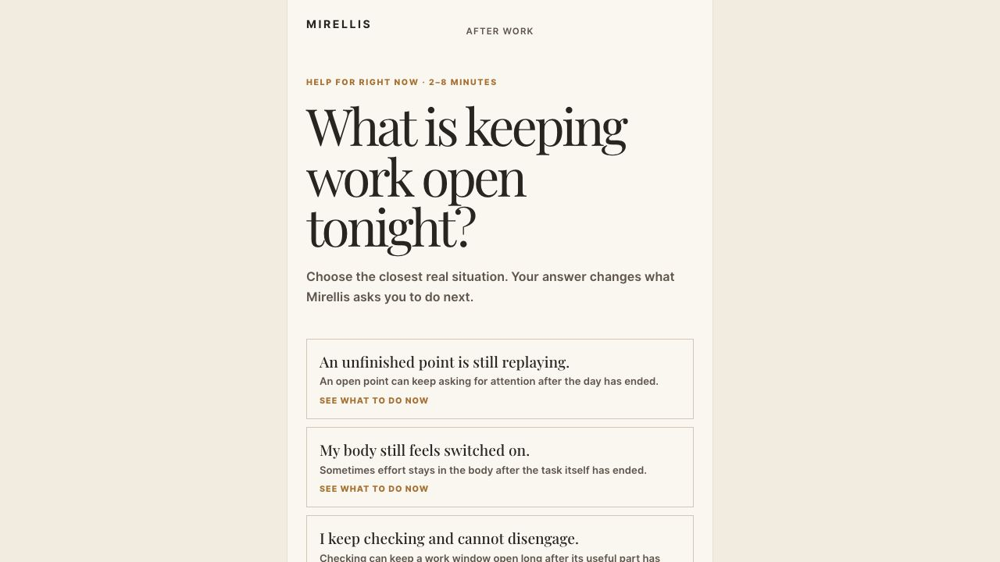

# Mirellis Website Future-Readiness Audit

Date: 12 August 2026  
Scope: live public website and the public app handoff  
Method: read-only visual and content audit of the homepage, After Work pathway, Observatory, Stillness product page, and app entry. No live-site changes were made.

## Executive verdict

The current release is a meaningful foundation, but it is not complete, not yet future-ready, and not sufficient to achieve the stated ambition of becoming a destination people discover, use, revisit, trust, and buy from.

The strongest improvements are the clearer Ritual Science positioning, coherent warm visual language, one problem-first After Work pathway, and a more useful website-to-app handoff. The largest gaps are trust and claims governance, inconsistent public architecture, lack of a repeat-use loop, weak acquisition infrastructure, and an incomplete revenue system.

Approximate readiness by dimension:

| Dimension | Current assessment |
| --- | --- |
| Visual identity | 7/10 |
| Narrative clarity | 6/10 |
| Immediate usefulness | 5/10 in the After Work pathway; materially lower elsewhere |
| Trust and evidence integrity | 3/10 |
| Retention / reason to return | 2/10 |
| Search and AI discoverability | 2/10 |
| Revenue readiness | 3/10 |
| Overall future readiness | About 4/10 |

These are directional audit judgments, not measured analytics scores.

## Evidence walk-through

### 1. Homepage

Health: promising visual foundation, but the first viewport is not efficient enough.

- The photography, palette, and typography feel recognisably Mirellis.
- The hero clearly signals an institutional point of view.
- The headline is so large that the supporting explanation and primary actions fall below the first viewport. A visitor sees atmosphere before enough meaning or action.
- The homepage sequence is conceptually sound: recognition, transitions, method, findings, routes, instruments, and Observatory.
- The public homepage presents three transition territories, while the current V1 app model has four transition families. This needs one explicit public architecture rather than parallel models.

### 2. After Work entry

Health: clear proposition, but the useful interaction starts too late.

- The opening problem is human and specific.
- The page visually becomes a long editorial document rather than a living service.
- The first meaningful choice/action is below the opening viewport.
- The pathway needs a shorter action layer above the deeper explanation.

### 3. After Work route response

Health: the strongest current experience.

- Selecting a real difficulty produces a consequential response.
- The action is concrete, bounded, and gives an immediate next step.
- Sound, practice, evidence, and an optional product can support one problem without pretending they are the same thing.
- This pattern should become the reusable core of the entire site.

### 4. Observatory opening

Health: visually coherent, but too generic to establish research authority.

- The page explains the institution at a high level.
- It does not yet make the evidence chain legible enough: observation, method, evidence status, source, limits, last review, and practical implication.
- The cards read as editorial themes more than accountable research records.

### 5. Observatory claims and counts

Health: critical trust risk.

- Public article/finding counts are shown without a transparent, verifiable register behind them.
- Several statements use causal, neurological, or diagnostic-sounding language without visible sourcing and qualification.
- Examples found across the live experience include claims about nervous-system recalibration, parasympathetic dominance, the first 30 minutes shaping the entire day, and insomnia-like experiences being the nervous system doing what it is designed to do.
- Homepage findings marked “Established” do not expose the evidence needed to justify that status.
- Some finding links lead to transition pages rather than dedicated finding records.

Required correction: create one governed claim and evidence register, then remove, qualify, or source every public claim against it.

### 6. Stillness product page

Health: beautiful and thoughtful, but too long and too claim-heavy for a confident purchase decision.

- The product photography and art direction are strong.
- Safety boundaries and usage cautions are better than most wellness product pages.
- Price, purchase context, suitability, and the essential decision information arrive too late in a long narrative.
- Claims about sensory signals, safety, downshifting, and nervous-system effects need the same evidence governance as Observatory claims.
- Recommended structure: concise decision layer first; full ritual, method, evidence, and story below.

### 7. App handoff

Health: visually coherent and problem-first, but currently a single vertical slice rather than a platform.

- The user is asked about a concrete situation and is told that the answer changes what happens next.
- The design language is consistent with the new After Work route.
- The website currently describes sharing an observation through “Mirror,” but the linked destination is the After Work app. That is a misleading promise and must be corrected.
- The app and the public institution need an explicit privacy model: private local companion by default, with separately consented participation if Observatory contribution is ever added.

## Major changes required

### P0 — Trust, truth, and canonical architecture

1. Establish one public transition taxonomy and one route map. Reconcile the homepage’s three territories with the app’s four V1 transition families without inventing additional curriculum.
2. Build a claims register. Every scientific, behavioural, product, and finding claim needs an owner, source, status, qualification, last-reviewed date, and approved public wording.
3. Replace unverified counts and unsupported “Established” labels with verifiable evidence records.
4. Fix misleading destinations: Mirror must not lead to an After Work tool, and findings must lead to actual finding records.
5. Run a global URL, naming, redirect, accessibility, product-safety, and consumer-copy review.

### P1 — Build a reason to return

6. Create a useful “Today” layer: one time/context-relevant practice, one sound, and one deeper resource. It should help in under two minutes and allow interruption without penalty.
7. Add private continuity: saved practices, unfinished/resume state, and a personal record. Keep it local-first by default; make any account sync or research participation separate and explicit.
8. Turn the Observatory into a real, filterable evidence library rather than a themed landing page.
9. Connect Spotify, YouTube, articles, findings, products, and app practices through one reusable problem-to-resolution content model.

### P1 — Acquisition and AI discoverability

10. Replace generic blogging with question-led problem pages built around real search intent. Each page should answer the question, show evidence and limits, offer one practice, and link to the appropriate sound, finding, tool, and optional product.
11. Add strong technical foundations: crawlable HTML, canonical URLs, sitemaps, structured data where valid, descriptive metadata, internal linking, authorship/review dates, and accessible citations.
12. Publish dedicated, machine-readable finding pages. Do not treat an `llms.txt` file or generic AI copy as a substitute for clear source-backed pages.
13. Build channel loops so Spotify, YouTube, Substack/Medium, Pinterest, and social content lead to useful canonical pages rather than isolated posts.

### P2 — Revenue and operating system

14. Rebuild product pages around an early decision layer: what it is, who it is for, what it is not, safety, price, and purchase action. Keep the long story as optional depth.
15. Measure the complete path with consented, privacy-respecting events: landing question, practice start, practice completion, return, product view, add to cart, checkout, and repeat use.
16. Only after the core consumer loop works, test paid programmes, ritual kits, institutional partnerships, directories, or listings. Adding these now would expand the catalogue before proving demand and return behaviour.

## Target experience architecture

The future site should have five clear jobs:

- **Today:** help with the current moment.
- **Library:** answer a specific question and teach.
- **Observatory:** show accountable evidence and limits.
- **Shop:** offer instruments connected to a practice and evidence dossier.
- **Private record:** preserve only what the person deliberately keeps.

The core loop should be:

`Search / AI / social / direct visit → specific problem page → useful practice → optional save or return → evidence, media, programme, or product`

## Product decision that must be made

Mirellis must explicitly decide whether V1 is:

1. a private, local-first practice companion; or
2. an Observatory-connected learning instrument.

The recommended launch position is the first. Research participation can be added later as a separate, opt-in system with clear consent, provenance, deletion, and no silent inference.

## Verification limits

- This audit did not have Search Console, analytics, sales, retention, or cohort data, so it cannot verify traffic, conversion, or repeat use.
- It did not complete a purchase.
- The responsive viewport control did not take effect in the in-app browser, so mobile visual quality is not certified by this audit.
- Screenshots and DOM inspection do not by themselves certify WCAG conformance; a dedicated keyboard, screen reader, contrast, reduced-motion, and target-size test is still required.

